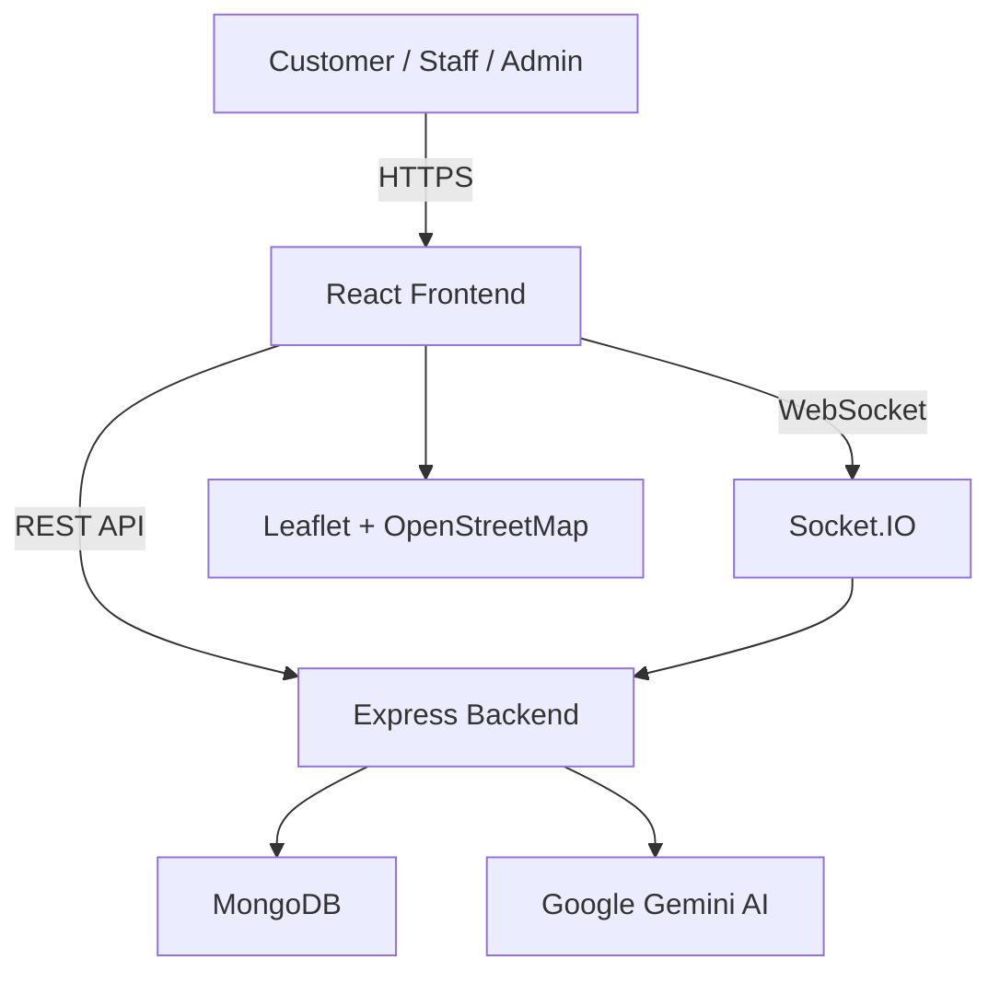

# QueueLess

**Say goodbye to waiting rooms.**

QueueLess is a smart queue and appointment management platform that eliminates the frustration of long, unpredictable waits. Customers can discover nearby service organisations — hospitals, banks, colleges, diagnostic labs, and government offices — book appointments, join digital queues, and track their position in real time, all from their phone. Staff manage queues with one-click controls, and administrators oversee organisation and staff verification from a centralised dashboard.

Built as a full-stack JavaScript application with real-time updates, AI-powered assistance, and interactive maps.

---

## 🚀 Features

### For Customers
- **Account Registration & Login** — Secure sign-up and authentication
- **Organisation Discovery** — Browse and search approved organisations by name, service, type, or city
- **Location-Based Search** — Use browser geolocation to find nearby organisations sorted by distance
- **Interactive Maps** — View organisations on a Leaflet + OpenStreetMap map with clickable markers
- **Appointment Booking** — Select a service, pick a slot, and receive a token number
- **Digital Queue** — Join a queue and track your position, people ahead, estimated wait time, and currently serving token
- **Real-Time Updates** — Queue status updates pushed via WebSockets without page refresh
- **AI Assistant** — Chat with a Gemini-powered assistant to find services, understand booking options, and check queue status
- **Offline Awareness** — Online/offline status detection with local storage of pending actions via IndexedDB

### For Staff
- **Staff Registration** — Request access to a specific organisation (pending admin approval)
- **Organisation Selection** — Staff assigned to multiple organisations can choose which one to manage
- **Queue Management** — Call next, mark serving, complete, skip, or recall customers
- **Appointment Management** — View and update appointment statuses

### For Administrators
- **Centralised Dashboard** — Manage the entire platform from one interface
- **Organisation Verification** — Approve or reject new organisation registration requests
- **Staff Approval** — Review and approve staff access requests with full context (organisation name, type, request date)
- **Secure Authentication** — Admin credentials configured through server environment variables; no hardcoded secrets

---

## 👥 User Roles

| Role | Access |
|------|--------|
| **Customer** | Browse organisations, book appointments, join queues, track status, chat with AI assistant |
| **Staff** | Manage queues and appointments for assigned organisations |
| **Admin** | Verify organisations, approve staff, oversee the entire platform |

- Admin credentials are set via backend environment variables (`ADMIN_EMAIL`, `ADMIN_PASSWORD`)
- There is no separate admin login page. Admins log in through the Customer or Staff login page and are automatically redirected to the Admin Dashboard based on their role

---

## 🏢 Supported Organisation Types

| Category | Examples in Demo Data |
|----------|-----------------------|
| Hospital | CityCare Hospital, Sunrise Multispeciality Hospital, MetroCare Hospital |
| Bank | SecureBank, National Trust Bank, CapitalBank |
| College | NIT Jamshedpur Student Services |
| University | Ranchi University Student Centre |
| Diagnostic Lab | LifeCheck Diagnostics, Prime Diagnostics |
| Government Service | Citizen Service Centre, Public Service Centre |

The platform ships with 12 demo organisations across Jamshedpur, Ranchi, and Patna — each with realistic services, coordinates, and business hours.

---

## 🧠 AI Assistance

QueueLess integrates **Google Gemini** as a conversational assistant for customers. The AI can:

- Help find available services across organisations
- Explain appointment and queue booking processes
- Report the customer's current queue status, position, and estimated wait time
- Guide users through the platform

**Safety boundaries:**
- The AI never diagnoses medical conditions, assigns medical urgency, or replaces human staff
- The Gemini API key is stored exclusively on the backend via the `GEMINI_API_KEY` environment variable and is never exposed to the frontend

---

## 📍 Location & Maps

- **Leaflet + OpenStreetMap** — Interactive map embedded in the organisation discovery page
- **Browser Geolocation** — "Use My Location" button requests permission and shows a personalised marker
- **Distance Calculation** — Haversine formula computes real distances between the user and every organisation
- **Sorted Results** — When location is available, organisations are automatically sorted nearest-first
- **Graceful Fallback** — If location access is denied, users can still search by city name

---

## 🔄 Queue Management

### Queue Lifecycle

```
Customer joins queue
       ↓
   [ Waiting ]
       ↓
Staff calls next → [ Called ]
       ↓
   [ Serving ]
       ↓
  [ Completed ]
```

Additional states: **Skipped**, **No-Show**, **Cancelled**

### How It Works
- **Customers** join a queue for a specific service and receive a token number. They can see their position, estimated wait time, and the currently serving token — all updating in real time via Socket.IO
- **Staff** manage queues with actions: Call Next, Complete, Skip, and Recall
- **Queue Rules** are configurable per organisation — including FIFO or priority-based strategies, max queue size, waitlist capacity, and allocation time windows

---

## 🏗️ System Architecture



---

## 🛠️ Tech Stack

| Category | Technology |
|----------|------------|
| Frontend | React 19, Vite, Tailwind CSS, React Router |
| UI Components | Lucide React (icons), custom Tailwind component library |
| Maps | Leaflet, React-Leaflet, OpenStreetMap |
| Backend | Node.js, Express 5 |
| Database | MongoDB, Mongoose |
| Authentication | JSON Web Tokens (JWT), bcryptjs |
| Real-Time | Socket.IO |
| AI | Google Gemini (`@google/genai`) |
| Offline Support | Service Worker, IndexedDB (`idb`) |
| Dev Tools | Vite, PostCSS, Autoprefixer |

---

## 📂 Project Structure

```
QueueLess/
├── backend/
│   ├── config/
│   │   └── db.js                  # MongoDB connection
│   ├── controllers/
│   │   ├── aiController.js        # Gemini AI chat
│   │   ├── appointmentController.js
│   │   ├── orgController.js       # Organisation search & distance
│   │   ├── queueController.js
│   │   ├── serviceController.js
│   │   └── userController.js      # Registration & login
│   ├── middleware/
│   │   └── auth.js                # JWT verification, role guards
│   ├── models/
│   │   ├── Appointment.js
│   │   ├── Counter.js
│   │   ├── Notification.js
│   │   ├── Organization.js
│   │   ├── QueueEntry.js
│   │   ├── QueueRule.js
│   │   ├── Service.js
│   │   ├── Staff.js
│   │   └── User.js
│   ├── routes/
│   │   ├── adminRoutes.js         # Organisation & staff verification
│   │   ├── aiRoutes.js
│   │   ├── appointmentRoutes.js
│   │   ├── orgRoutes.js
│   │   ├── queueRoutes.js
│   │   ├── serviceRoutes.js
│   │   └── userRoutes.js
│   ├── scripts/
│   │   └── seed.js                # Demo data seeder
│   ├── services/
│   │   ├── notificationService.js
│   │   └── queueService.js        # Queue engine (FIFO, priority, waitlist)
│   ├── socket.js                  # Socket.IO initialisation
│   └── server.js                  # Application entry point
│
├── frontend/
│   ├── public/
│   │   └── sw.js                  # Service Worker
│   ├── src/
│   │   ├── components/
│   │   │   ├── chat/
│   │   │   │   └── ChatWidget.jsx # AI assistant floating widget
│   │   │   ├── layout/
│   │   │   │   ├── MainLayout.jsx
│   │   │   │   └── ProtectedRoute.jsx
│   │   │   └── ui/                # Reusable UI components
│   │   ├── context/
│   │   │   ├── AuthContext.jsx    # Authentication state
│   │   │   ├── NetworkContext.jsx # Online/offline & sync
│   │   │   └── SocketContext.jsx  # WebSocket connection
│   │   ├── pages/
│   │   │   ├── AdminDashboard.jsx
│   │   │   ├── BookAppointment.jsx
│   │   │   ├── CustomerDashboard.jsx
│   │   │   ├── Home.jsx
│   │   │   ├── Login.jsx
│   │   │   ├── Organizations.jsx  # Search, map, geolocation
│   │   │   ├── QueueStatus.jsx
│   │   │   ├── Register.jsx
│   │   │   ├── RegisterOrganization.jsx
│   │   │   ├── RegisterStaff.jsx
│   │   │   ├── Services.jsx
│   │   │   └── StaffDashboard.jsx
│   │   ├── utils/
│   │   │   └── idb.js             # IndexedDB helpers
│   │   └── App.jsx
│   └── vite.config.js
│
└── README.md
```

---

## ⚙️ Installation & Setup

### Prerequisites

- **Node.js** (v18 or later)
- **MongoDB** — either a local instance or a [MongoDB Atlas](https://www.mongodb.com/atlas) cluster
- **Google Gemini API Key** — obtain from [Google AI Studio](https://aistudio.google.com/apikey) (optional, for AI assistant)

### 1. Clone the Repository

```bash
git clone <repository-url>
cd QueueLess
```

### 2. Backend Setup

```bash
cd backend
npm install
```

Create a `.env` file in the `backend/` directory:

```env
MONGO_URI=your_mongodb_connection_string
JWT_SECRET=your_jwt_secret
ADMIN_EMAIL=your_admin_email
ADMIN_PASSWORD=your_admin_password
GEMINI_API_KEY=your_gemini_api_key
CLIENT_URL=http://localhost:5173
```

> ⚠️ **Never commit the `.env` file.** It is already listed in `.gitignore`.

### 3. Seed Demo Data (Optional)

```bash
node scripts/seed.js
```

This populates the database with 12 demo organisations, 47 services, staff accounts, customer accounts, and sample queue entries.

### 4. Start the Backend

```bash
npm start
```

You should see:

```
Connecting to database...
Database connected successfully
Server running in development mode on port 5001
```

### 5. Frontend Setup

Open a new terminal:

```bash
cd frontend
npm install
```

### 6. Start the Frontend

```bash
npm run dev
```

The application will be available at **http://localhost:5173**.

The Vite dev server automatically proxies `/api` and `/socket.io` requests to the backend on port 5001.

---

## 🔌 API Endpoints

| Method | Endpoint | Auth | Description |
|--------|----------|------|-------------|
| `POST` | `/api/users/register` | — | Customer registration |
| `POST` | `/api/users/register-staff` | — | Staff registration (pending approval) |
| `POST` | `/api/users/login` | — | Login (returns JWT) |
| `GET` | `/api/users/profile` | ✅ | Get current user profile |
| `GET` | `/api/organizations` | — | Search organisations (supports `?search=`, `?type=`, `?lat=`, `?lng=`) |
| `GET` | `/api/organizations/:id` | — | Get organisation details |
| `GET` | `/api/services/org/:orgId` | — | Get services for an organisation |
| `POST` | `/api/appointments` | ✅ | Book an appointment |
| `GET` | `/api/appointments/my` | ✅ | Get customer's appointments |
| `POST` | `/api/queue/join` | ✅ | Join a queue |
| `GET` | `/api/queue/my-status` | ✅ | Get customer's queue status |
| `POST` | `/api/queue/call-next` | 🔒 Staff | Call next in queue |
| `POST` | `/api/queue/complete` | 🔒 Staff | Complete current customer |
| `POST` | `/api/queue/skip` | 🔒 Staff | Skip current customer |
| `POST` | `/api/queue/recall` | 🔒 Staff | Recall skipped customer |
| `POST` | `/api/ai/chat` | ✅ | Chat with AI assistant |
| `GET` | `/api/admin/pending-orgs` | 🔒 Admin | Get pending organisation requests |
| `POST` | `/api/admin/verify-org` | 🔒 Admin | Approve/reject organisation |
| `GET` | `/api/admin/pending-staff` | 🔒 Admin | Get pending staff requests |
| `POST` | `/api/admin/verify-staff` | 🔒 Admin | Approve/reject staff |
| `GET` | `/api/health` | — | Health check |

---

## 🔐 Security

- Passwords are hashed with **bcryptjs** before storage
- Authentication uses **JSON Web Tokens** with configurable expiry
- All admin credentials are sourced from environment variables — never hardcoded
- Role-based middleware (`requireAuth`, `requireAdmin`, `requireStaff`) protects sensitive endpoints
- Staff can only manage queues for their assigned organisations
- The Gemini API key never leaves the server
- MongoDB connection strings and secrets are excluded from version control via `.gitignore`

---

## 📱 Responsive Design

The interface is built with **Tailwind CSS** and designed mobile-first. Key pages — organisation search, queue tracking, appointment booking, and staff management — are fully responsive and usable on phones, tablets, and desktops.

---

## 📄 License

This project is for educational and portfolio purposes.

---

<p align="center">
  Built with ❤️ for a world without waiting rooms.
</p>
